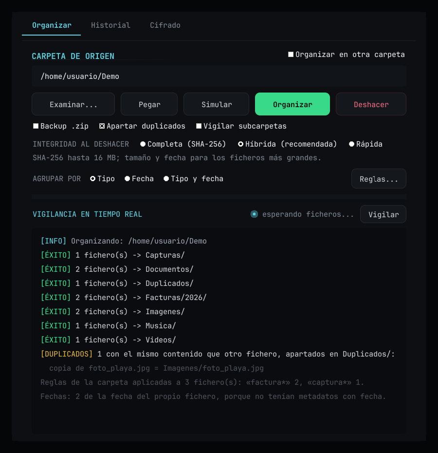
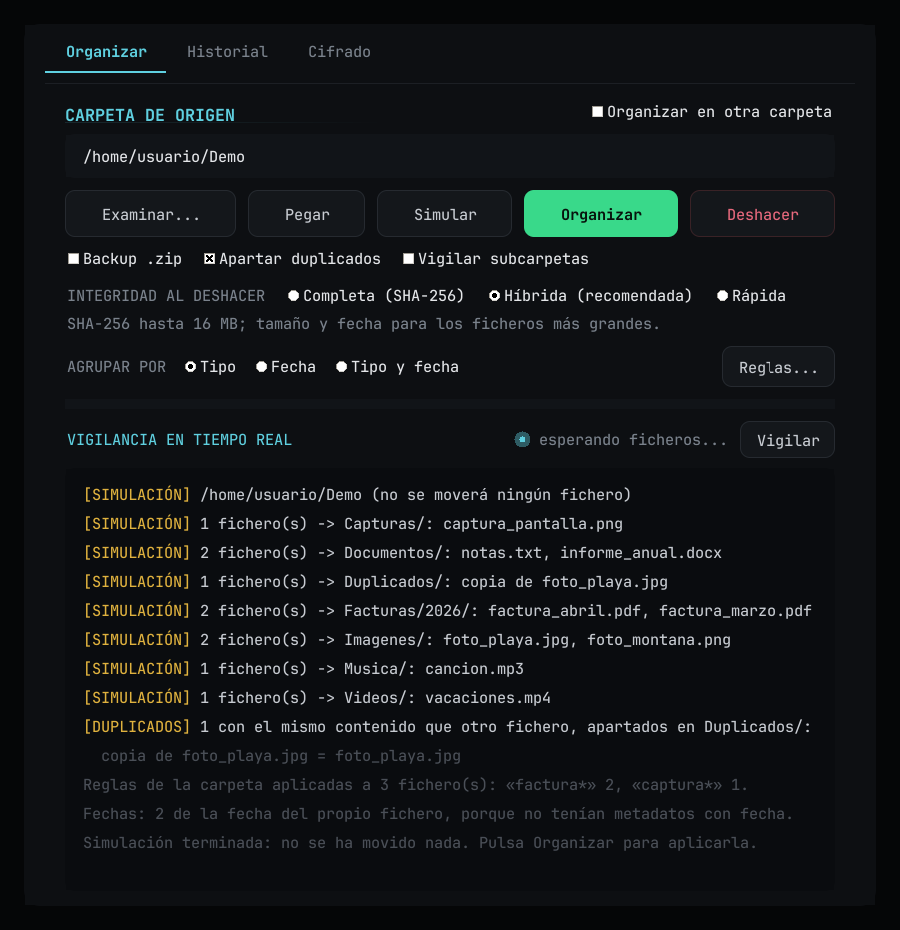
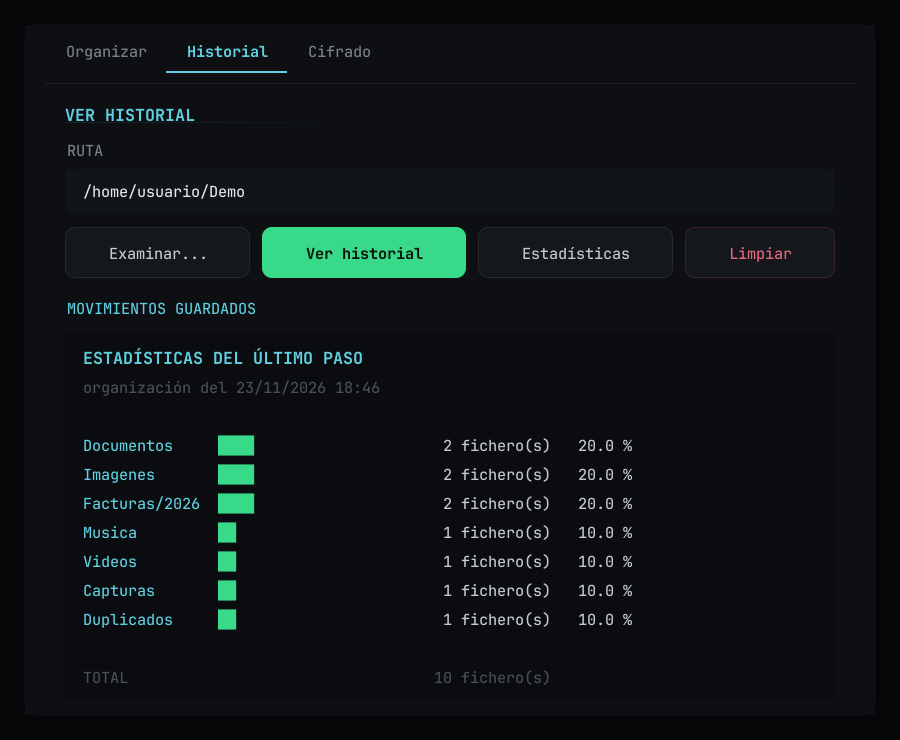
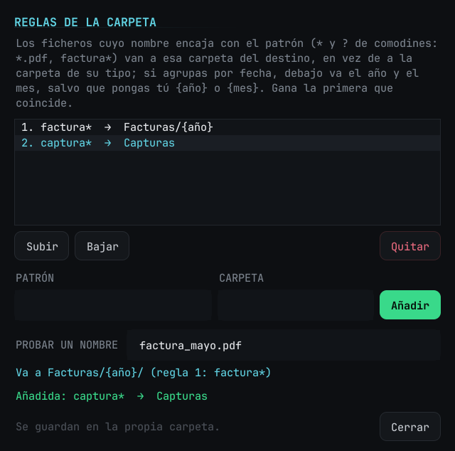

# file-organizer

[](https://github.com/pier0del/file-organizer/actions/workflows/ci.yml)

Ordena los ficheros de una carpeta en subcarpetas por tipo (`Imagenes/`, `Documentos/`…), por fecha (`2024/03/`) o por las dos. Todo se puede deshacer.

Se usa con ventana, con un menú en la terminal o con comandos.

> [!WARNING]
> **Versión beta (0.9.0): puede tener errores.** El programa mueve ficheros reales: usa primero **Simular** o activa el **Backup .zip** antes de organizar carpetas importantes. Si encuentras un fallo, [abre un issue](https://github.com/pier0del/file-organizer/issues).

---

<p align="center">
  
</p>

## Qué hace

- **Organiza** por tipo de fichero, por fecha o por tipo y fecha. La fecha sale de los metadatos (EXIF de las fotos, grabación de los vídeos, creación de PDF y Office) y, si no los hay, de la del fichero.
- **Deshace** paso a paso, como Ctrl+Z.
- **Simula** antes de mover nada.
- **Detecta duplicados** por contenido, no por nombre, y nunca los borra.
- **Reglas propias** por carpeta: `factura*` → `Facturas/{año}`.
- **Vigila** una carpeta y organiza lo que va llegando, como las descargas.
- **Cifra** ficheros y carpetas con AES-256-GCM, con contraseña o con fichero de clave.
- **Copia de seguridad** opcional en `.zip` antes de organizar.

---

## Instalación

Necesitas **Python 3.11 o posterior** y [uv](https://docs.astral.sh/uv/).

1. Instala uv, si no lo tienes:

   ```bash
   # Windows (PowerShell)
   powershell -ExecutionPolicy ByPass -c "irm https://astral.sh/uv/install.ps1 | iex"
   # macOS y Linux
   curl -LsSf https://astral.sh/uv/install.sh | sh
   ```

2. Descarga el proyecto e instálalo:

   ```bash
   git clone https://github.com/pier0del/file-organizer.git
   cd file-organizer
   uv sync
   ```

3. Ábrelo:

   ```bash
   uv run file-organizer-gui
   ```

Para tener los comandos disponibles en cualquier terminal, sin el código: `uv tool install .` desde la carpeta del proyecto.

<details>
<summary>Sin uv (con pip)</summary>

```bash
python -m venv .venv
.venv\Scripts\Activate.ps1      # Windows (PowerShell)
source .venv/bin/activate        # macOS y Linux
pip install .
```
</details>

<details>
<summary>Si la ventana no se abre</summary>

La ventana usa `tkinter`, que normalmente viene con Python.

- **Linux:** en algunas distribuciones va aparte. En Debian y Ubuntu: `sudo apt install python3-tk`.
- **Windows:** si sale `TclError: Can't find a usable init.tcl`, repara Python desde su instalador marcando **«tcl/tk and IDLE»**.
- **macOS con el Python de Homebrew:** si sale `No module named '_tkinter'`, instálalo con `brew install python-tk@3.12` (cambia `3.12` por tu versión).
- **macOS, con el proyecto en `~/Documents` o `~/Desktop`:** si sale `No module named 'file_organizer'`, es porque iCloud oculta ficheros del entorno virtual. Mueve el proyecto a otra carpeta, borra `.venv` y ejecuta `uv sync` otra vez.
</details>

---

## Cómo se usa

| Forma | Comando | Para |
|---|---|---|
| Ventana | `file-organizer-gui` | El uso diario |
| Menú en la terminal | `file-organizer` | Ir paso a paso sin recordar opciones |
| Comandos | `file-organizer --carpeta RUTA [opciones]` | Scripts y automatización |

Las tres hacen lo mismo. La ventana y el menú recuerdan tu última carpeta y tus preferencias.

Escribe `uv run` delante de los comandos, o activa antes el entorno: `source .venv/bin/activate` en macOS y Linux, `.venv\Scripts\Activate.ps1` en Windows.

### Primeros pasos

```bash
file-organizer --carpeta ~/Descargas --simular   # muestra qué haría, sin mover nada
file-organizer --carpeta ~/Descargas             # organiza
file-organizer --carpeta ~/Descargas --deshacer  # lo devuelve todo a su sitio
```

Puedes pegar las rutas tal como las copias: entre comillas, arrastradas a la terminal o con `~`.

---

## Organizar

| `--agrupar` | Dónde queda `foto.jpg` de marzo de 2024 |
|---|---|
| `tipo` (por defecto) | `Imagenes/foto.jpg` |
| `fecha` | `2024/03/foto.jpg` |
| `tipo-fecha` | `Imagenes/2024/03/foto.jpg` |

Opciones útiles:

- `--destino RUTA`: organiza en otra carpeta en vez de en la misma.
- `--backup`: crea antes un `.zip` con la carpeta.
- `--duplicados mover`: aparta los ficheros repetidos en `Duplicados/`. Sin ella, solo avisa.

En la ventana son las opciones de la pestaña **Organizar**.

<p align="center">
  
</p>

---

## Deshacer

Cada vez que organizas, o cada sesión de vigilancia, se guarda un **paso** en el historial. *Deshacer* revierte el último paso; si lo repites, el anterior, y así hasta 20 pasos.

- Si el sitio original está ocupado, no sobrescribe: restaura con otro nombre (`foto_1.jpg`).
- Borra las carpetas que se quedan vacías, pero nunca otras tuyas.
- Si organizaste en otra carpeta, indica el mismo destino para deshacer.

```bash
file-organizer --carpeta ~/Descargas --historial          # ver los pasos guardados
file-organizer --carpeta ~/Descargas --estadisticas       # qué se movió en el último paso
file-organizer --carpeta ~/Descargas --limpiar-historial  # olvidar el historial (no mueve nada)
```

**Comprobar si un fichero cambió.** Al deshacer se avisa si un fichero se modificó después de organizarlo. Elige cuánto leer con `--integridad`, o en la ventana:

| Modo | Qué comprueba | Coste |
|---|---|---|
| `hibrida` (por defecto) | Contenido completo hasta 16 MB; tamaño y fecha en los más grandes | Casi nulo |
| `completa` | El contenido completo de todos (SHA-256) | Lee todos los ficheros |
| `rapida` | Solo el tamaño y la fecha | Nulo |

<p align="center">
  
</p>

---

## Duplicados

Un duplicado es un fichero con el **mismo contenido** que otro, se llame como se llame: `copia de foto.jpg` es duplicado de `foto.jpg` si es la misma imagen.

- `--duplicados avisar` (por defecto): se organiza normal y se avisa.
- `--duplicados mover`: se aparta en `Duplicados/` para que lo revises.

Nunca se borra ninguno. Se conserva el que ya estaba organizado o, si llegan juntos, el de nombre más corto.

---

## Reglas de cada carpeta

Mandan ficheros concretos a la carpeta que tú digas, por su nombre. Ganan a las categorías y se aplican solas al organizar y al vigilar.

| Patrón | Carpeta | Resultado |
|---|---|---|
| `factura*` | `Facturas/{año}` | `Factura_marzo.pdf` → `Facturas/2024/` |
| `*.pdf` | `Documentos` | Todos los PDF, a `Documentos/` |
| `IMG_????.jpg` | `Fotos del móvil/{año}/{mes}` | Las fotos del móvil, por año y mes |

<p align="center">
  
</p>

- `*` es cualquier texto y `?`, un carácter. No distingue mayúsculas.
- `{año}` y `{mes}` se cambian por la fecha del fichero.
- **Gana la primera regla que coincide**: pon primero las más concretas.
- La carpeta siempre queda dentro del destino, para que se pueda deshacer.

```bash
file-organizer --carpeta ~/Descargas --agregar-regla "factura*" "Facturas/{año}"
file-organizer --carpeta ~/Descargas --reglas          # ver las reglas, numeradas
file-organizer --carpeta ~/Descargas --quitar-regla 1
```

En la ventana: **Reglas…** → *Reglas de esta carpeta…*, donde además puedes probar adónde iría un nombre. Se guardan en `.file-organizer-reglas.json`, dentro de la carpeta.

---

## Vigilar una carpeta

Organiza cada fichero nuevo en cuanto llega.

```bash
file-organizer --carpeta ~/Descargas --vigilar
file-organizer --carpeta ~/Descargas --vigilar --vigilar-recursivo   # también las subcarpetas
```

- Espera unos segundos y comprueba que el fichero ya no cambia antes de moverlo.
- Las descargas de Chrome, Edge y Firefox se organizan cuando terminan.
- Cada sesión de vigilancia es un paso del historial, así que se puede deshacer.
- Mientras se vigila una carpeta, no se puede organizar ni deshacer en ella desde otra ventana.

---

## Cifrar

```bash
file-organizer --cifrar informe.pdf --contrasena       # te pide la contraseña sin mostrarla
file-organizer --descifrar informe.pdf.enc --contrasena

file-organizer --generar-clave mi_clave.key            # o usa un fichero de clave
file-organizer --cifrar ~/Documentos --archivo-clave mi_clave.key
```

- Cifra con **AES-256-GCM**. Con contraseña, la clave se deriva con PBKDF2-HMAC-SHA256 (480.000 iteraciones); con fichero de clave, con HKDF-SHA256. Cada fichero tiene su propia clave.
- Detecta cualquier cambio en el `.enc`: si alguien lo manipula, no se descifra.
- Va por bloques, así que un vídeo de varios GB apenas usa memoria.
- Se conserva el original, salvo que pidas `--borrar-original`.
- Con una carpeta, entra también en las subcarpetas; `--no-recursivo` lo evita.
- **Guarda bien la contraseña o el `.key`**: sin ellos no hay forma de recuperar los ficheros.
- No oculta el nombre del fichero ni su tamaño aproximado.

Los `.enc` de versiones anteriores del programa se siguen pudiendo descifrar.

---

## Categorías propias

Las categorías por defecto (Imagenes, Videos, Musica, Documentos, Codigo, Datos, Comprimidos…) deciden por la extensión. Para cambiarlas, expórtalas, edita el JSON y úsalo:

```bash
file-organizer --exportar-categorias mis_categorias.json
file-organizer --carpeta ~/Descargas --config mis_categorias.json
```

```json
{
    "Imagenes": [".jpg", ".png"],
    "Documentos": [".pdf", ".docx"]
}
```

En la ventana: **Reglas…** → *Exportar categorías…* e *Importar categorías…*.

---

## Ignorar ficheros

Crea un `.file-organizer-ignore` en la carpeta, con la misma sintaxis que `.gitignore`:

```gitignore
*.log
*temp*
proyectos/
```

---

## Ficheros que crea

| Fichero | Dónde | Qué es |
|---|---|---|
| `.file-organizer-history.json` | Carpeta de destino | Historial para deshacer |
| `.file-organizer-backups/` | Carpeta de destino | Copias `.zip` |
| `.file-organizer.lock` | Carpeta de destino | Evita dos operaciones a la vez |
| `.file-organizer-reglas.json` | Carpeta organizada | Sus reglas |
| `.file-organizer-ignore` | Carpeta organizada | Lo que no se organiza (lo creas tú) |
| `~/.file-organizer/config.json` | Tu carpeta personal | Última carpeta y preferencias |
| `file-organizer.log` | Donde ejecutas el programa | Registro de actividad (1 MB, 3 copias) |

**Privacidad.** Todos estos ficheros llevan nombres y rutas de tus ficheros. En macOS y Linux solo tú puedes leerlos. Ninguno guarda contraseñas.

**Seguridad.** Deshacer solo mueve ficheros dentro de las carpetas elegidas: si alguien manipula el historial para sacar ficheros de ellas, con `..` o con enlaces, el historial se rechaza.

---

## Desarrollo

```bash
uv run pytest          # 769 tests
uv run ruff check .    # estilo
uv run ruff format .   # formato
uv run mypy            # tipos (modo estricto)
```

- En Windows se omiten 16 tests y en macOS 3, que solo tienen sentido en otros sistemas.
- Los de la ventana necesitan pantalla y `tkinter`.

```
src/file_organizer/
├── organizador.py      # Coordina todo: la ventana, el menú y los comandos solo hablan con él
├── clasificador.py     # Decide la carpeta: por tipo, por fecha o por los dos
├── metadatos.py        # Lee la fecha de fotos, vídeos y documentos
├── reglas.py           # Reglas de cada carpeta
├── duplicados.py       # Encuentra ficheros con el mismo contenido
├── mover_archivos.py   # Mueve ficheros y deshace
├── historial.py        # Lee y guarda el historial
├── vigilante.py        # Vigilancia en tiempo real
├── cifrador.py         # Cifrado y descifrado
├── rutas.py            # Prepara y comprueba las rutas que escribe el usuario
├── cli/                # Comandos y menú de la terminal
└── gui/                # Ventana (Tkinter)
```

Dependencias: [cryptography](https://cryptography.io/), [watchdog](https://python-watchdog.readthedocs.io/), [filelock](https://py-filelock.readthedocs.io/) y [colorama](https://pypi.org/project/colorama/).

---

## Estado del proyecto (beta)

**Probado:** los 769 tests pasan en Linux (Python 3.11, 3.12 y 3.14) y en macOS (Python 3.12). En Windows se han pasado con Python 3.14.

**Falta probar:** el uso real durante tiempo: carpetas con muchos miles de ficheros, vigilar durante horas, discos externos y unidades de red.

**Mientras sea beta:**
- Usa **Simular** antes de organizar una carpeta por primera vez.
- Activa el **Backup .zip** en carpetas importantes.
- Antes de usar `--borrar-original` al cifrar, comprueba que sabes descifrar ese fichero.

### Informar de un fallo

[Abre un issue](https://github.com/pier0del/file-organizer/issues) con:

- tu sistema y tu versión de Python (`python --version`);
- qué hiciste (ventana, menú o comando, con sus opciones);
- qué esperabas y qué pasó, con el mensaje de error.

El `file-organizer.log` ayuda, pero lleva tus rutas: quita lo que no quieras enseñar antes de pegarlo.

---

## Licencia

MIT. Ver [LICENSE](LICENSE). Se ofrece tal cual, sin garantías.

**Autor:** pier0del_
